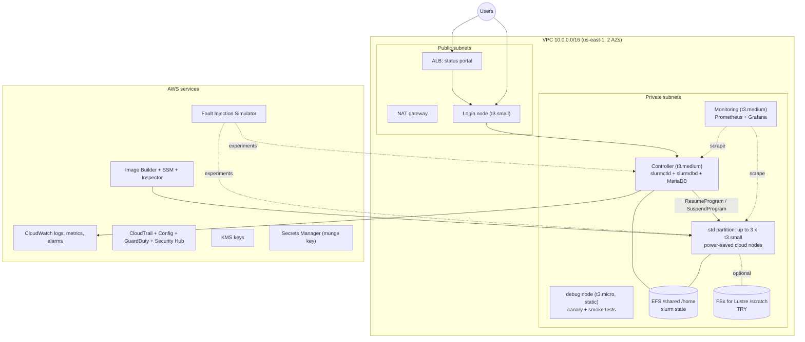

# Design: HPC Platform Operations Test Bed

Implements `requirements.md`. Scope tags used below: BUILD, SIMULATE, TRY, DESIGN-ONLY.

## 1. Overview

A scaled-down Slurm cluster on small EC2 instances, wrapped in the operating practices of a production HPC service: SLIs and alerts, runbooks, image and patch lifecycle, audit evidence, fault injection and service reporting. Everything is created by Terraform and automation scripts so that an expired sandbox costs nothing but time.

### Key decisions

| # | Decision | Reason |
|---|---|---|
| D1 | Self-managed Slurm on EC2 with power-save cloud bursting, not AWS PCS | PCS is not listed in the sandbox. Power-save reproduces the elastic-queue behaviour (Req 5). |
| D2 | Amazon Linux 2023 for all nodes | No Marketplace subscription needed. Rocky Linux is a stretch goal. |
| D3 | Controller state on EFS | Lets the controller be replaced and recover queued jobs, which is the basis of the controller-loss experiment (Req 4.3, 12.3). |
| D4 | `slurmdbd` and MariaDB on the controller | Saves an RDS instance and a slot in the setup. RDS t4g.micro is an optional upgrade. |
| D5 | Self-hosted Prometheus and Grafana on one t3.medium | Managed Prometheus and Grafana are not supported. |
| D6 | AMI promotion through SSM Parameter Store | Launch templates resolve the current AMI from a parameter, so rollback is a parameter swap (Req 10.4). |
| D7 | CI runs static gates only. Plan and apply run from the sandbox session | Sandbox credentials are temporary, so GitHub cannot hold them. A production OIDC deploy pipeline is documented as DESIGN-ONLY. |
| D8 | No interface VPC endpoints, no Transit Gateway, no PrivateLink | Will not work in the sandbox. |

## 2. Architecture

## 3. Instance and resource budget

| Role | Type | Count | Notes |
|---|---|---|---|
| Controller | t3.medium | 1 | slurmctld, slurmdbd, MariaDB |
| Login | t3.small | 1 | Job submission, optional NICE DCV (TRY: may need t3.medium) |
| Monitoring | t3.medium | 1 | Prometheus, Grafana, Slurm exporter |
| `debug` node | t3.micro | 1 | Static and always on, so canaries never wait on a power-up |
| `std` nodes | t3.small | up to 3 | Cloud nodes, power-saved |
| **Total running** | | **7** | |
| Image Builder reserve | | 2 | Build and test instances count toward the cap |
| **Cap** | | **9** | Stopped instances also count |

Lambda budget (cap 10 functions): probe, service-report, image-promote, inspector-ticket, resume/suspend helper (optional), PIR summariser (optional). Target 6 or fewer.

## 4. Components

### 4.1 Network (Req 3)
- Terraform module `network`: VPC, 2 public and 2 private subnets, route tables, one NAT gateway, security groups per tier (login, controller, compute, monitoring, ALB, EFS), Route 53 private zone `hpc.internal`, VPC Flow Logs to CloudWatch.
- Gateway endpoints for S3 only. No interface endpoints.
- Fallback if the NAT gateway is blocked or unaffordable: private nodes use public subnets with restrictive security groups. Record in `docs/sandbox-notes.md`.

### 4.2 Slurm controller (Req 4)
- Config templates (`slurm.conf`, `slurmdbd.conf`, `cgroup.conf`) rendered by Terraform `templatefile` or cloud-init, so the config lives in version control.
- Munge key generated once and stored in Secrets Manager (KMS-encrypted). Nodes fetch it at boot with an instance role.
- `StateSaveLocation` on EFS (`/shared/slurm-state`).
- Accounting enabled with `slurmdbd`; `AccountingStorageEnforce` on for realism.
- Version pinned in `slurm_version` variable. Slurm is built into the AMI by an Image Builder component.

### 4.3 Elastic compute (Req 5)
- Partitions: `debug` (static t3.micro, 30-minute limit, default for canaries) and `std` (cloud nodes `State=CLOUD`, up to 3).
- `SuspendTime=300`, `ResumeTimeout=300`, `SuspendTimeout=120` as starting values to tune.
- `ResumeProgram` (Python, `automation/python/slurm_resume.py`): reads node names from Slurm, launches instances from the launch template, tags them, registers DNS in the private zone, and logs structured events.
- `SuspendProgram` (`slurm_suspend.py`): terminates instances and removes DNS records.
- On launch failure (for example `InsufficientInstanceCapacity`): call `scontrol update NodeName=... State=DOWN Reason="..."`, emit a CloudWatch metric and let the alarm fire.
- Each resume records `resume_latency_seconds` as a CloudWatch custom metric.

### 4.4 Storage (Req 6)
- EFS mounted at `/shared` and `/home` on every node. Used for Slurm state and job data.
- FSx for Lustre (TRY): smallest allowed scratch deployment, created only by `make fsx-up` in a short session, mounted at `/scratch`, benchmarked with a simple `fio` or `dd` run, then destroyed. If blocked, record the error in `docs/sandbox-notes.md` and continue with EFS.
- Alarms: EFS burst credit balance, free space on local volumes, FSx free capacity (when present).

### 4.5 Access, identity and portal (Req 9)
- ALB in front of a small read-only status service (Python, FastAPI or Flask) on the login node. It shows `sinfo` state, queue depth and last canary results, with `/healthz` for the ALB.
- Identity (TRY): Simple AD with LDAP and SSSD for 2 to 3 test users. Fallback: local users provisioned from a YAML file.
- NICE DCV (TRY): install on the login node if the instance size and licensing allow. Otherwise record the limitation.
- RES: DESIGN-ONLY ADR.

### 4.6 Scheduler operations tooling (Req 7)
- `automation/python/hpcops/` package with sub-commands:
  - `drain-node --node N --reason R [--reboot]`: set drain, wait for jobs to finish with a timeout, run the action through SSM Run Command, verify the node is idle, resume.
  - `diagnose-job --job ID`: collect `scontrol show job`, `sacct`, node state, recent `slurmctld` and `slurmd` log lines.
  - `diagnose-node --node N`: node state, reason, last registration, instance state, system logs.
  - `requeue-stuck` with dry-run default.
- Destructive actions need `--yes`. Every action appends a JSON line to `evidence/ops-log.jsonl`.

### 4.7 Observability (Req 8)

SLIs:

| SLI | Source | Example SLO |
|---|---|---|
| Scheduler availability | Probe: `scontrol ping` plus port 6817 check every minute | 99.5% |
| Job start latency (warm) | Canary job on `debug` every 5 minutes | p95 < 30 s |
| Job start latency (cold) | Canary job on `std` hourly, includes resume time | p95 < 6 min |
| Queue wait time | Slurm exporter | p95 < threshold per partition |
| Login/portal availability | ALB health plus external probe Lambda | 99.5% |
| Storage health | EFS and FSx CloudWatch metrics | No exhausted credits or capacity |
| Node resume failures | Custom metric | 0 per day |

- Prometheus (Slurm exporter, node_exporter) with Grafana dashboards provisioned from files in the repo.
- CloudWatch agent on every node for system logs and Slurm logs. Alarms route to an SNS topic.
- Every alarm has the tags `severity`, `sli` and `runbook`, which CI checks.
- `docs/alert-tuning.md` logs each threshold change with the noise it removed.

### 4.8 Image and patch lifecycle (Req 10)
- Image Builder pipeline: AL2023 base, components for hardening, Slurm build and install, node_exporter, CloudWatch agent. Scheduled weekly, produces versioned AMIs.
- Inspector scans the images and running instances. `inspector-ticket` Lambda turns findings above a threshold into a markdown ticket in S3 with a remediation due date.
- `image-promote` Lambda (or script): runs a smoke test on a candidate AMI, then writes SSM parameters `/hpc-testbed/ami/compute/current` and `/previous`.
- The compute launch template uses `resolve:ssm:/hpc-testbed/ami/compute/current`. Rollback is `make ami-rollback`, which swaps the parameters.
- Static nodes (controller, login, monitoring) are patched with Patch Manager in a maintenance window, using the drain-patch-verify-rejoin steps from 4.6 where Slurm is affected.

### 4.9 Security and audit (Req 11)
- KMS customer-managed keys for EBS, EFS, S3, CloudWatch Logs and Secrets Manager, with rotation enabled.
- IAM: one role per node type with least privilege. Resume and suspend permissions are limited to tagged instances.
- CloudTrail (multi-region off to stay in budget) to an encrypted S3 bucket with log file validation. Config recorder with rules: `encrypted-volumes`, `s3-bucket-public-read-prohibited`, `required-tags`, `iam-policy-no-statements-with-admin-access`, `cloudtrail-enabled`. GuardDuty and Security Hub enabled in this account only.
- Evidence collector (`automation/python/evidence.py`): gathers IAM summary, KMS key policies and rotation status, CloudTrail validation status, Config compliance, patch compliance and AMI inventory. It writes a timestamped folder under `evidence/` with `manifest.json` containing SHA-256 hashes.

### 4.10 Incident management and resilience (Req 12, 15)
- `docs/incident-lifecycle.md`: severity definitions, triage, response roles, escalation, customer communication templates, closure and PIR deadline.
- `incidents/templates/pir.md`: blameless template with timeline, contributing factors, what went well, corrective actions table (ID, owner, due date, status).
- FIS experiments as Terraform (`fis-experiments` module), each at most 5 minutes so that three fit inside the 20-minute budget:
  1. Stop a running `std` node mid-job. Hypothesis: the job requeues and the node recovers.
  2. Disrupt connectivity for one private subnet (AZ-loss simulation). Hypothesis: the alarms fire and the runbook restores service.
  3. DNS failure: an SSM document run through FIS temporarily blocks DNS from the controller. Hypothesis: probes detect it within 2 minutes.
  4. Optional: stop the controller. Hypothesis: state on EFS allows recovery with queued jobs intact.
- Runbooks follow `runbooks/_template.md`: trigger, impact, diagnosis, action, verification, escalation, evidence.

### 4.11 CI/CD and drift (Req 13)
- GitHub Actions on pull request: `terraform fmt -check`, `validate`, `tflint`, `checkov`, `shellcheck`, `ruff`, `pytest`, runbook-link check, alert-tag check, instance-type policy check.
- Plan, apply and drift detection run from the sandbox session:
  - `make plan` and `make apply` save plan output into `evidence/`.
  - `make drift` runs `terraform plan -detailed-exitcode` and records the result.
- Rollback: `git revert` plus `make apply` for infrastructure, SSM parameter swap for AMIs. Documented in `docs/rollback.md`.
- A DESIGN-ONLY ADR describes the production pipeline (OIDC, approvals, separate state per environment).

### 4.12 Reporting, capacity and cost (Req 14)
- `automation/python/service_report.py`: reads CloudWatch metrics, probe results, Config compliance, incident files and the change log, and writes `docs/service-reports/YYYY-MM.md` (availability vs SLO, incidents, changes, capacity, findings).
- Capacity: linear-trend forecast of queue depth and node-hours with a note on its limits.
- Anomalies: z-score on daily instance-hours and node utilisation. The report states that billing data is unavailable in the sandbox.

## 5. Data models

- **Node event** (JSON line): `ts, node, event(resume|suspend|fail|drain|return), instance_id, latency_s, reason`.
- **Probe result** (CloudWatch metric): `ProbeName, Success(0|1), LatencyMs`.
- **Canary result**: `partition, submit_ts, start_ts, end_ts, start_latency_s`.
- **Incident file** (markdown with YAML front matter): `id, severity, start, end, services, status, actions[]`.
- **Evidence manifest**: `session, generated_at, files[{path, sha256}]`, `tool_versions`.
- **SSM parameters**: `/hpc-testbed/ami/compute/{current,previous}`, `/hpc-testbed/slurm/version`.

## 6. Error handling

| Failure | Handling |
|---|---|
| EC2 launch failure | Mark node DOWN with reason, metric, alarm, runbook. |
| Instance cap reached (9) | Preflight blocks apply. Resume program refuses and logs. |
| Credentials expire mid-run | Scripts exit cleanly with a clear message. Terraform state stays local and consistent. |
| Session expires | Everything is rebuilt by `make up`. Evidence was exported by `make down` or periodic `make evidence`. |
| FSx or NAT or DCV blocked | Documented fallback, recorded in `docs/sandbox-notes.md`. |
| Bedrock token budget (optional feature) | Guard stops calls before 20,000 tokens or 50 invocations. |

## 7. Testing strategy

- **Unit:** pytest with moto for the resume and suspend programs, evidence collector, report generator and ops CLI.
- **Static:** terraform validate, tflint, checkov, a custom policy check for instance types and regions.
- **Terraform tests:** `terraform test` for module outputs and variable validation.
- **Integration (in session):** scheduler smoke tests (submit, run, complete, cancel), cold-start canary, drain workflow.
- **Resilience:** the FIS experiments, each with a hypothesis and a PIR.
- **Docs:** CI check that every alert links to a runbook and every runbook link resolves.

## 8. Session workflow

1. Write code offline. This needs no sandbox session.
2. Start a session, run `make preflight`, then `make up`.
3. Run the tasks marked SANDBOX, collecting evidence as you go.
4. Run `make evidence` and `make down`, then commit evidence and notes.

Keep sessions short and purposeful. The `tasks.md` file marks which tasks need a live session.
