# End-to-End Test Guide

Evidence pack for a full sandbox session of the HPC Platform Operations Test Bed  
(self-managed Slurm on AWS EC2). Aligns with the architecture in  
[`.kiro/specs/hpc-platform-ops/design.md`](../.kiro/specs/hpc-platform-ops/design.md)  
and the quick-start flow in the [README](../README.md).

**Session reference:** `hpc-testbed-dev-070bc5b7` (us-east-1, Oct 2026)  
**Screenshots:** [`tests/scheduler/`](../tests/scheduler/)  
**FSx:** left on the V2 baseline (optional `make fsx-up`; not required for this E2E).

---

## 1. Architecture under test

From the design document (BUILD path; FSx remains TRY / optional):

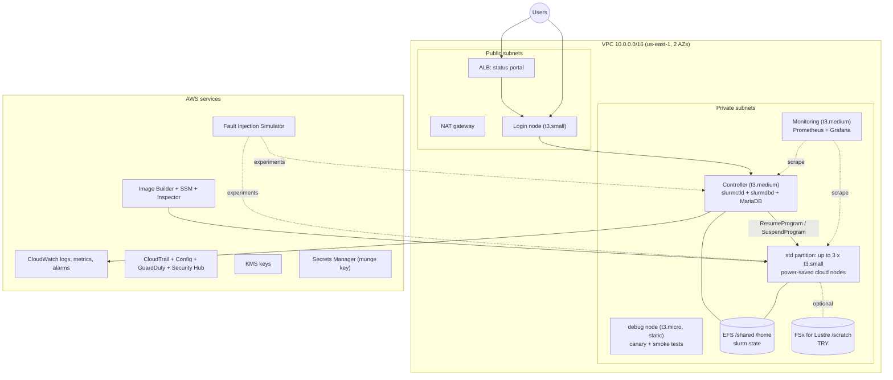

| Role | Type | Role in E2E |
|------|------|-------------|
| Controller | t3.medium | `slurmctld`, `slurmdbd`, munge; state on EFS |
| Login | t3.small | Job submit, status portal backend, smoke runner |
| Debug | t3.micro | Static partition for warm canaries |
| std | t3.small (CLOUD) | Power-save / cold-start path |
| Monitoring | t3.medium | Prometheus + Grafana via portal ALB |
| EFS | regional | `/shared`, `/home`, Slurm state |
| MariaDB RDS | db.t4g.micro | Accounting DB (`slurm_acct_db`) |

---

## 2. Prerequisites

```bash
# Offline / CI
make lint test

# Live session
make preflight
make up                 # foundation (network, storage, image pipeline) — does NOT build AMI
make ami-build          # Image Builder run + promote to SSM (45–90 min)
make up                 # re-apply so controller / login / debug use HPC AMI
```

Image Builder pipeline is **scheduled only** (Sunday 02:00 UTC).  
`terraform apply` does not execute it — use `make ami-build` (or `TF_VAR_build_ami_on_apply=true`).

---

## 3. E2E checklist

### 3.1 Infrastructure up

| Check | Expected | Evidence |
|-------|----------|----------|
| EC2 core nodes running | login (t3.small), debug (t3.micro), controller (t3.medium) | [ec2-instances.jpg](../tests/scheduler/ec2-instances.jpg) |
| EFS available | Encrypted FS; access points `/shared` and `/home` | [efs.jpg](../tests/scheduler/efs.jpg) |
| MariaDB available | `db.t4g.micro`, DB name `slurm_acct_db`, status Available | [rds.jpg](../tests/scheduler/rds.jpg) |
| Status checks | 3/3 passed on all three instances | EC2 console |

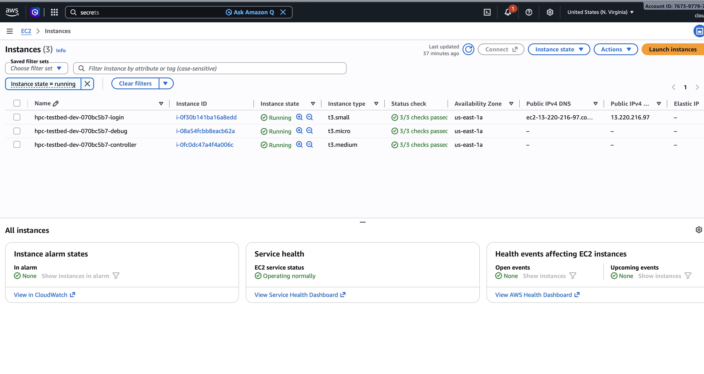

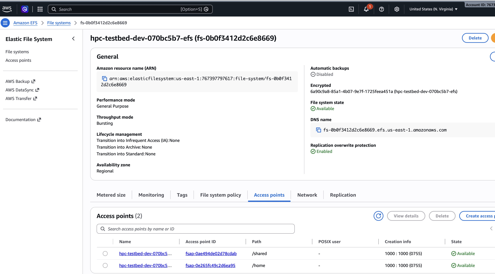

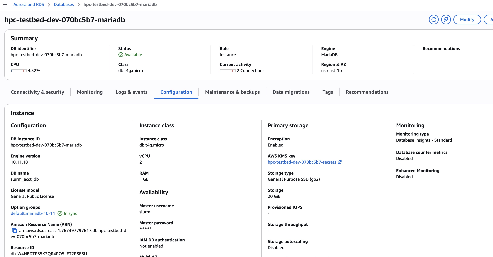

### 3.2 Controller services

On the controller (SSM Session Manager):

```bash
systemctl status slurmctld slurmdbd munge
```

Expected: `slurmctld` and `slurmdbd` **active (running)**; munge **active**.  
`slurmd` on the controller is expected **inactive** (controller is not a compute node).

| Shot | What it shows |
|------|----------------|
| [controlller-node-1.jpg](../tests/scheduler/controlller-node-1.jpg) | `slurmctld` + `slurmdbd` active; job submit/complete/kill in journal |
| [controller-node.jpg](../tests/scheduler/controller-node.jpg) | `slurmctld` + munge; job lifecycle log lines |
| [controller-node-2.jpg](../tests/scheduler/controller-node-2.jpg) … [controller-node-6.jpg](../tests/scheduler/controller-node-6.jpg) | Additional controller journal / status captures |

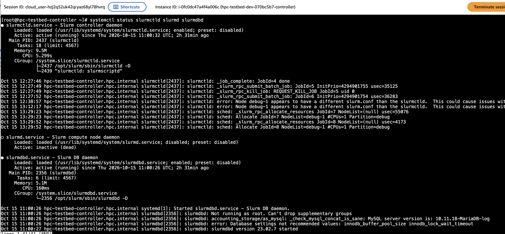

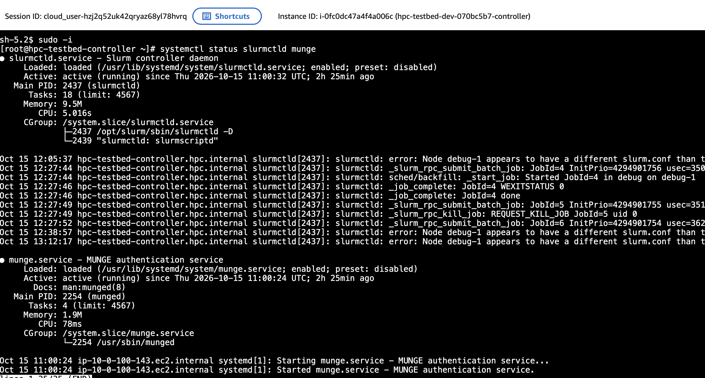

**Note (observed):** intermittent `Node debug-1 appears to have a different slurm.conf` warnings are visible in controller logs; debug jobs still complete. Track as a config-sync follow-up if it persists after AMI rebuild.

### 3.3 Debug node

```bash
systemctl status slurmd munge
```

Expected: both **active (running)**; Slurm 23.02.x; job launch lines in journal.

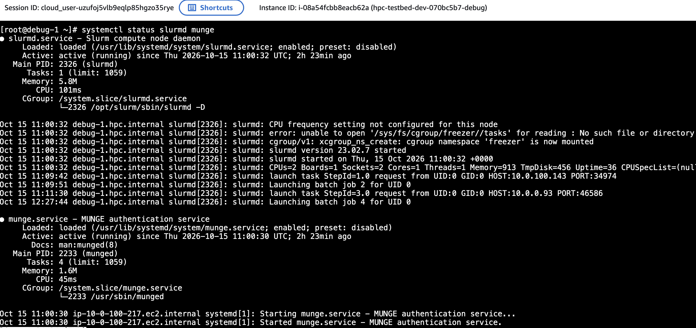

### 3.4 Login node and shared storage

```bash
df -h /shared /shared/slurm-state
ls -la /shared/
systemctl status munge
command -v sinfo && sinfo -V
sinfo
scontrol show node debug-1
```

Expected:

- EFS mounted at `/shared` (cluster, home, slurm-state, software, smoke)
- munge active
- `sinfo` / Slurm client binaries under `/opt/slurm`
- `debug` partition **up**, node `debug-1` **idle**

| Shot | Content |
|------|---------|
| [login.jpg](../tests/scheduler/login.jpg) | EFS layout, munge, `sinfo -V` (23.02.7) |
| [login-node-1.jpg](../tests/scheduler/login-node-1.jpg) | `sinfo`, `squeue`, `scontrol show node debug-1` |
| [login-node-2.jpg](../tests/scheduler/login-node-2.jpg) | Additional login checks |

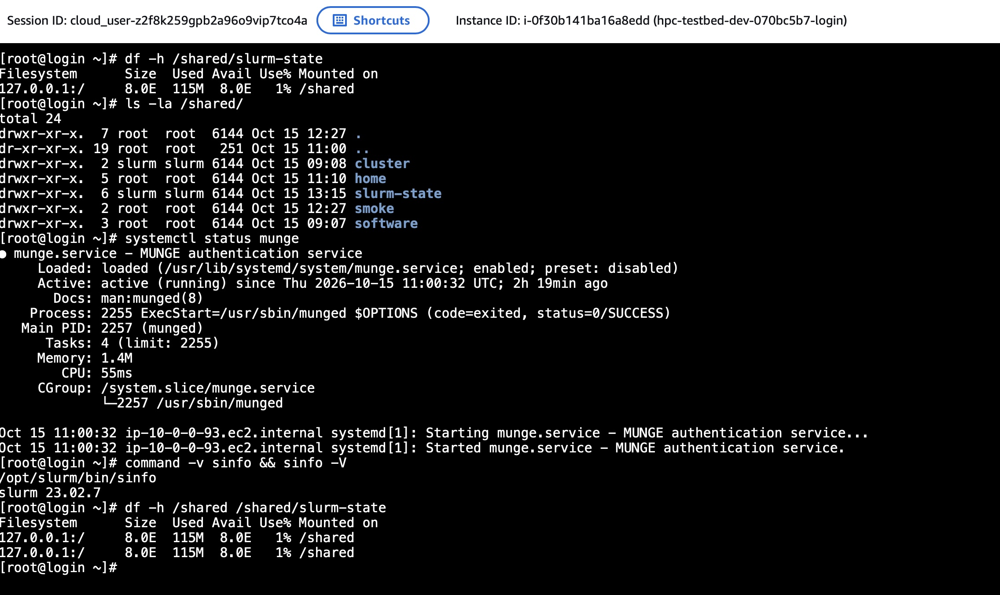

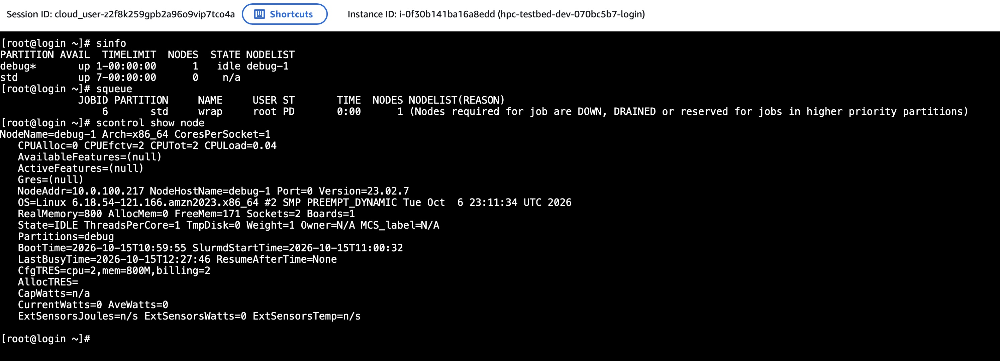

### 3.5 Scheduler smoke tests

From the login node (script: [`tests/scheduler/test_smoke.sh`](../tests/scheduler/test_smoke.sh)):

```bash
tests/scheduler/test_smoke.sh
```

Covers:

1. Submit + complete trivial job on **debug**
2. Cancel a running/pending job on **debug**
3. Cold-start submit on **std** (may need ResumeTimeout / elastic capacity)

**Recorded result (session 070bc5b7):**

```
PASS: submitted debug job 4
PASS: job 4 completed
PASS: job 5 cancelled
PASS: submitted std job 6 (cold start may apply)
FAIL: std job 6 (may need elastic capacity)
=== Results: 4 passed, 1 failed ===
```

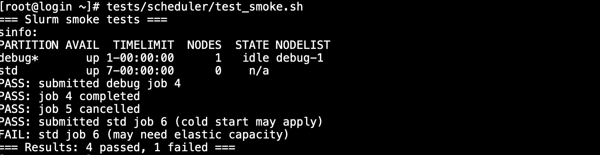

Accounting view:

```bash
sacct
```

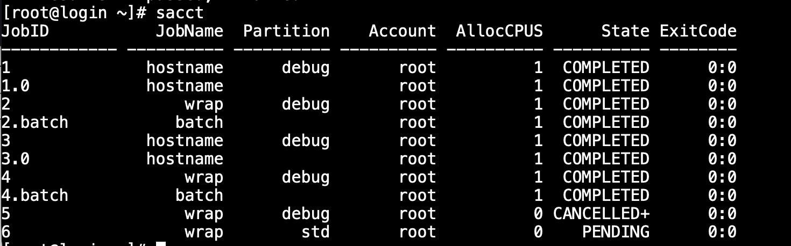

| Job | Partition | State | Notes |
|-----|-----------|-------|--------|
| 1–4 | debug | COMPLETED | Warm path OK |
| 5 | debug | CANCELLED | Cancel path OK |
| 6 | std | PENDING | Cold-start / power-save not yet completing nodes |

**std cold-start:** treat as partial until a std node reaches IDLE and the job completes. Confirm ResumeProgram logs, launch template AMI (SSM `/hpc-testbed/ami/compute/current`), and instance budget (cap 9).

### 3.6 Status portal

ALB → login status service:

- Shows `sinfo` (debug idle; std nodes listed as idle- or power-saved depending on session)
- Empty or recent canary list
- Timestamped refresh

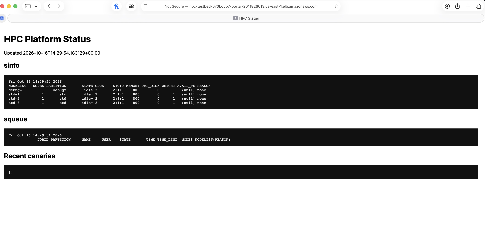

### 3.7 Observability

**Grafana** (via portal path `/grafana`):

- Folder **HPC** with dashboards: cAdvisor, Docker monitoring, **HPC Overview**, Node Exporter Full
- HPC Overview: targets up, CPU/memory/disk, container CPU

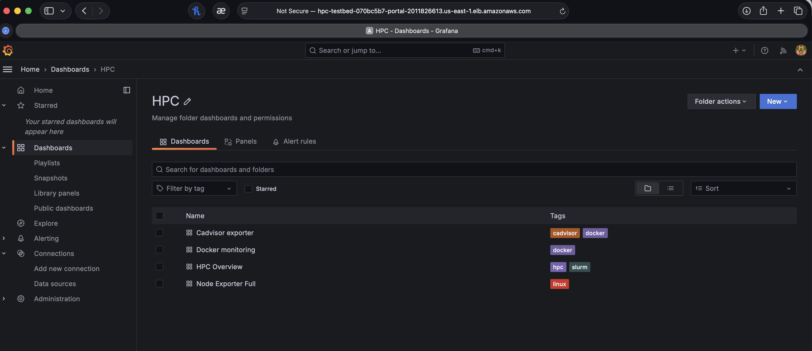

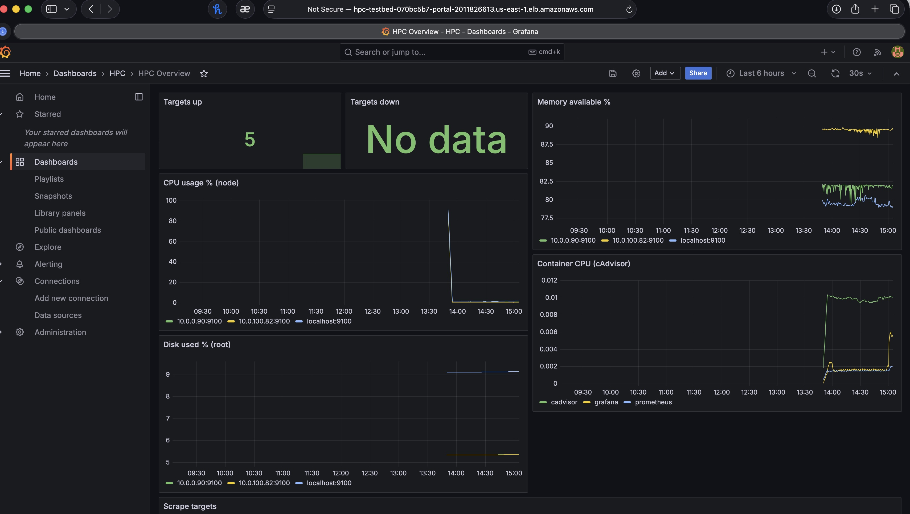

**CloudWatch alarms** (sample set):

| Alarm | Role |
|-------|------|
| `hpc-testbed-scheduler-availability` | Scheduler health probe |
| `hpc-testbed-job-start-latency-warm` / `-cold` | Canary latency |
| `hpc-testbed-resume-failures` | Power-save resume failures |
| `hpc-testbed-portal-availability` | ALB / portal |
| `hpc-testbed-efs-burst-credits` (+ per-node variants) | Storage health |

Some may show **In alarm** early in the session (probe warm-up, portal health before traffic). Confirm tags `severity` / `sli` / `runbook` and that actions are enabled on the primary SLI alarms.

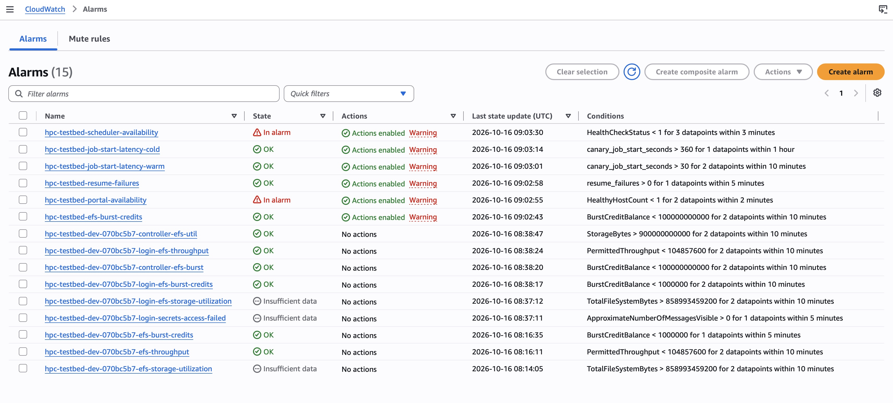

---

## 4. Pass / fail criteria

| Area | Pass when |
|------|-----------|
| Core instances | login + controller + debug running, 3/3 status checks |
| EFS | Available; `/shared` and `/home` access points; mounted on nodes |
| Accounting DB | MariaDB Available; slurmdbd connected |
| Controller | slurmctld + slurmdbd + munge active |
| Debug | slurmd + munge active; accepts debug jobs |
| Login | munge active; `sinfo` works; EFS visible |
| Smoke (debug) | submit → complete and cancel both PASS |
| Smoke (std) | submit accepted; ideally COMPLETED after resume (document PENDING if capacity/resume lag) |
| Portal | Loads sinfo/squeue without 5xx |
| Grafana | HPC Overview reachable; at least node_exporter targets up |
| Alarms | Primary SLI alarms present; false alarms noted in `docs/alert-tuning.md` |

Optional (not required for baseline E2E):

- `make fsx-up` + mount `/scratch` + `scripts/fsx_benchmark.py`
- FIS templates, drain/patch runbooks, full `make evidence`

---

## 5. Reproduce this session

```bash
make preflight
make up
make ami-build          # wait for promote
make up                 # instances on HPC AMI
# wait for controller bootstrap (15–25 min first boot if compiling to EFS)
# SSM → login:
tests/scheduler/test_smoke.sh
sacct
# browser: portal ALB DNS, /grafana
make evidence
make down
```

Capture new screenshots under `tests/scheduler/` with the same naming pattern (or dated subfolder) and update this doc’s “Session reference” line.

---

## 6. Known gaps from this run

1. **std cold-start incomplete** — job 6 stayed PENDING; elastic resume path needs verification (ResumeProgram, AMI in SSM, SG, capacity).
2. **slurm.conf drift warning** — controller vs debug-1; prefer single rendered config from EFS or AMI.
3. **Portal / scheduler alarms In alarm** early — re-check after probes run for several minutes; tune if noisy (`docs/alert-tuning.md`).
4. **FSx** — intentionally not exercised (V2 baseline); use `make fsx-up` / `fsx-down` when sandbox allows.

---

## 7. Related docs

| Doc | Purpose |
|-----|---------|
| [README.md](../README.md) | Quick start, make targets, constraints |
| [design.md](../.kiro/specs/hpc-platform-ops/design.md) | Architecture, SLIs, component design |
| [sandbox-notes.md](sandbox-notes.md) | TRY path outcomes (FSx, AD, DCV) |
| [instance-budget.md](instance-budget.md) | Cap 9 and role sizes |
| [controller-operations.md](controller-operations.md) | Controller ops |
| [login-node-operations.md](login-node-operations.md) | Login ops |
| [alert-tuning.md](alert-tuning.md) | Alarm threshold changes |
| [rollback.md](rollback.md) | Infra / AMI rollback |
| [tests/scheduler/test_smoke.sh](../tests/scheduler/test_smoke.sh) | Automated smoke script |
